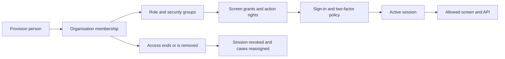

# MIMS user access, security groups and sessions — module audit

Status: IN PROGRESS. Findings and suggestions only. No module sign-off.

Owner: John (review voice in this session). Baseline: frozen commit 9c940bf9. Runtime: isolated local MIMS/CP audit databases; local mail receivers; general schedulers off. No app fixes or pushes.

## Scope and proof

This module covers Users and Bulk Add, Group Security, Sign-in & Security, Company Login, organisation/site access boundaries, personal password/recovery/two-factor/passkey flows, Session Management and Logged In Users. It does not resume the broad clinical/content audit. Cross-screen cases are synthetic targets for authorization checks.

A pass applies only to its named scenario. A source review is not a runtime pass. A failed scenario remains a finding, not completed acceptance. Login/browser obstacles are handed to Rohith promptly; no repeated sign-in automation.

## Scenario register

| Area | Executed evidence | Remaining checks |
|---|---|---|
| Single-user provisioning | Normal contractor creation; required date, past and excessive-date rejection; receiving group/role/membership | Duplicate/invalid fields, all optional fields, all role combinations, SSO-only person, concurrent edits |
| Bulk provisioning | Template/file/paste, empty/quoted CSV, 501-row UI limit, duplicate batch rollback, two-user success | Backend size limit, exact boundary, malformed/duplicate headers, mixed permissions, all format cases |
| Users filters/export | Search, role-zero-result, receiving synthetic rows, network failure/retry | Status/group combinations, saved views, pagination, export reconciliation beyond observed role defect |
| User changes | Screen grant/revoke and restoration; normal password change/history; deactivation/reactivation reason and session end | Disabled state, forced expiry/reset, unlock, shared-person edits, case-admin/platform flags, audit-link actions |
| Groups | Create/template/cancel, search, granted filter, member add/remove, empty-group delete, first-category selection/collapse | All templates/categories, populated-group delete, duplicate names, default-group API protection, concurrent changes |
| Separation of duties | Author+approver in same group and across two memberships both rejected | Grant changes to existing members, role-default conflicts, removal/replacement, advisory rules |
| Effective access | Explicit grant immediately affects API; role-default preview discrepancy | Every capability and own/all scope, all memberships, inactive/expired groups, module interactions |
| Client/platform sign-in policy | Client scope denies other client/platform settings; platform range negatives and restoration; local TLS mail | Remaining bounds/types, actual idle/lockout enforcement, all client switches, policy changes during sessions |
| Password recovery | Wrong/correct code, short/mismatch, normal reset, sequential replay, competing concurrent reset | Code expiry/attempt cap, generic-response comparison, live-session effect, deactivation/expiry between stages |
| Two-factor | TOTP and email setup; wrong/resend/old-code rejection; sequential backup single-use; remembered browser versus fresh browser | Assisted post-reset sign-in, reset during pending challenge, attempt lockout/unlock, code expiry/concurrency, changed policy |
| Two-factor reset | Normal platform reset clears secret, codes and device records; existing live session still reads cases | Assisted proof that old remembered cookie no longer skips setup; explicit session-revocation policy |
| Sessions | Client admin sees own tenant, foreign sign-out denied, local agent sign-out invalidates cached session | Personal session screen controls, multiple devices/orgs, own sign-out, timeout renewal/expiry, failed-cache handling |
| Contractor end | Single-user date policy; controlled existing sweep removes membership, revokes session, returns case to Unassigned | Multiple organisations/dates, notifications on receiving screen, renewal workflow, sweep failure recovery |
| Organisation/site boundaries | Foreign user visibility and sign-in settings denied; foreign-case read/export discrepancy previously reproduced | Real org switch, per-org screens/roles/MFA, site scopes/read-only/IP rules, inactive org/site and access expiry |
| Company login | Source tracing only; copied providers disabled in audit copy | Provider setup/save/test, domain routing, callback/state/issuer checks, link/unlink, deprovisioning, failure paths |
| Passkeys | Setup invitation and Not now observed; source tracing | Register, cancel, sign-in, removal, wrong origin/challenge/user, reset/deactivation interactions |

## Findings carried into this module

| Reference | Evidence-backed issue |
|---|---|
| A03 | Alternate single-case inspector export bypasses organisation restriction; broader export retest still pending |
| A07 | Role demotion leaves old administrative session claims usable |
| A13 | Response logging exposes the session cookie |
| A15 | Saved landing-screen preference ignored on sign-in |
| A22 | Some read-only users receive controls whose actions the server rejects |
| A29 | Effective-access preview omits inherited role rights and scopes |
| A30 | Human privilege changes shown as System in group history |
| A31 | Platform-admin timeout accepts more than its UI maximum |
| A32 | User with allowed non-Cases modules lands at No System Access |
| A33 | User CSV drops role/status/group filters |
| A34 | Quoted CSV department becomes unintended SSO identifier |
| A35 | Bulk personal-email contractor cannot supply required end date |
| A36 | One recovery token accepts competing concurrent password changes; password history loses an accepted intermediate password |

Full reproductions, limits and suggestions are in the existing findings report. They are not new independent findings in this module register.

## Additional observed behaviour — two-factor reset

Platform admin 463 resets synthetic user 466 through Users → Quick Actions → Reset 2FA. Before: one live session, one trusted device, ten backup codes (one used). After: settings disabled/secret cleared, devices zero, codes zero. Existing session remains and GET auth/me and synthetic case 483113 both return 200. The reset endpoint does not call session revocation.

Recommendation: decide whether a two-factor reset is also a security-recovery action that must end existing sessions. If it is intended only to re-enrol a factor at the next sign-in, say so explicitly and provide a combined recovery action. No claim of a stated session-revocation requirement or actual account compromise is made.

Assisted check requested: user 466 was signed out normally, email prefilled, and Rohith asked to complete its password step and leave the next setup screen open. No subsequent sign-in result is assumed.

## References

- docs/RULES.md; docs/PRD.md (MIMS administration/security); docs/TASKS.md; docs/PROGRESS.md.
- docs/tasks/2026-11-13-deep-product-audit.md — numbered findings and baseline history.
- docs/tasks/audit-20261113/execution-ledger.md — detailed executed scenarios.
- docs/tasks/audit-20261113/control-inventory.json; control-coverage.md; frontend-reachability.json — source checklist, not completion percentages.
- Frozen source: backend/routes/platformAdmin.js:688-704; backend/middleware/auth.js; backend/middleware/caseAccess.js; backend/controllers/authController.js; frontend/modules/mimsadmin/components/tabs/Users.jsx; frontend/modules/max/pages/SessionManagementPage.jsx.
